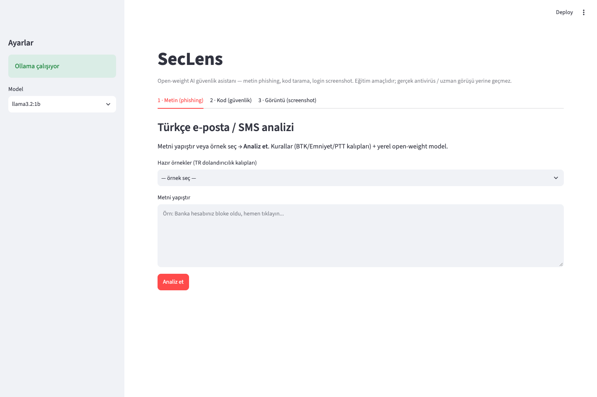
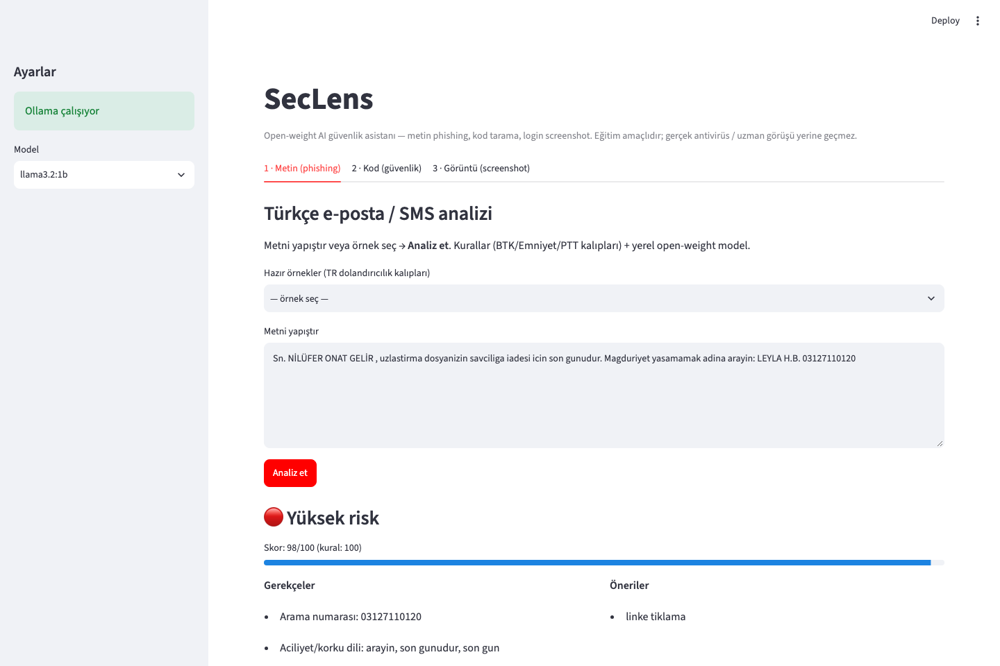
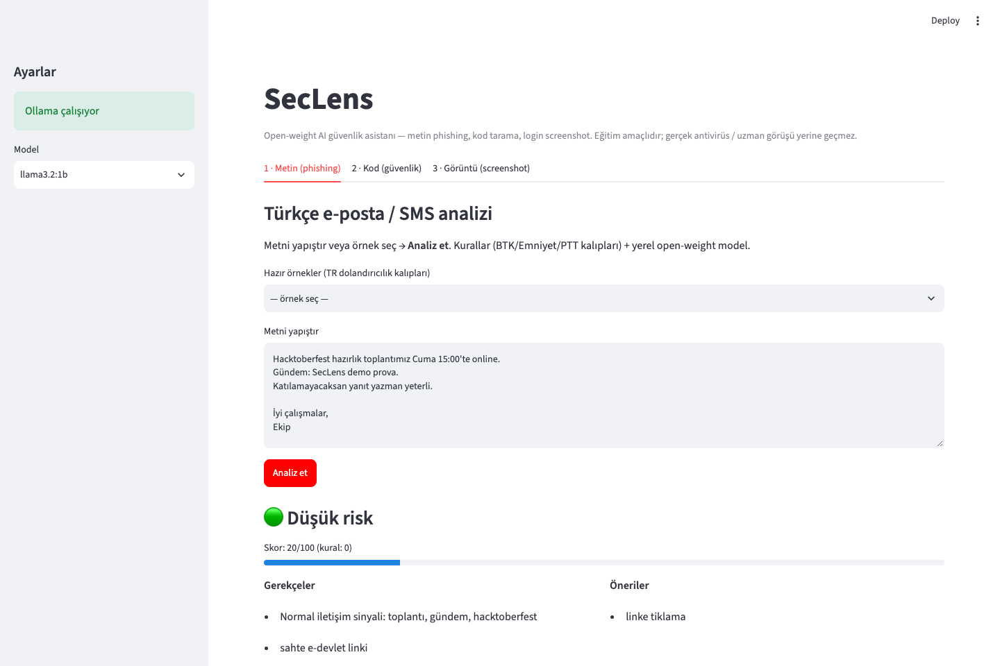
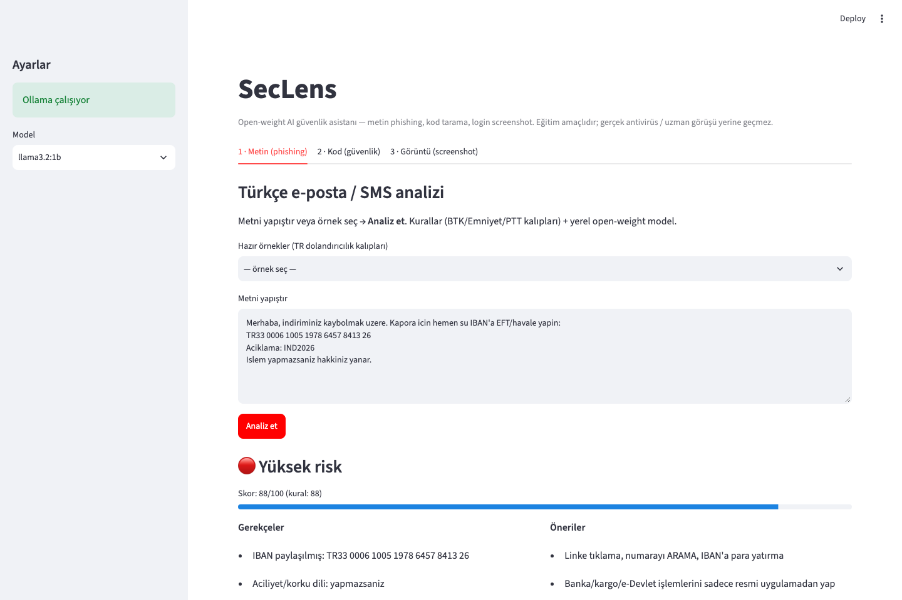
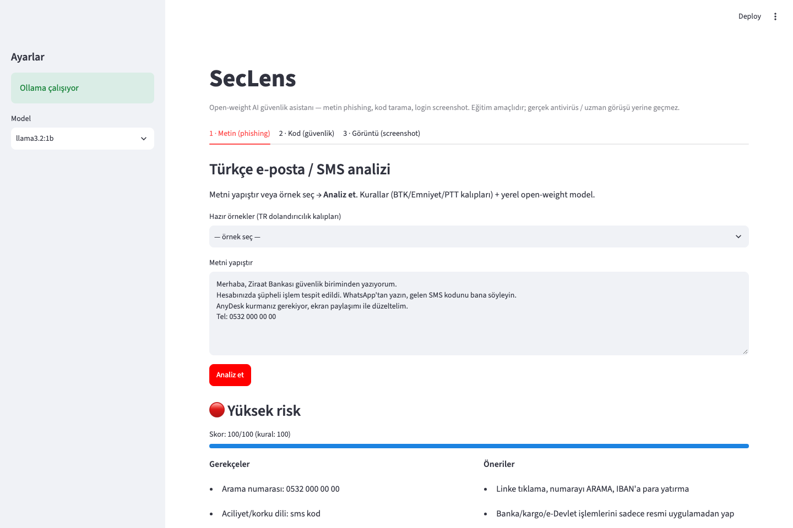
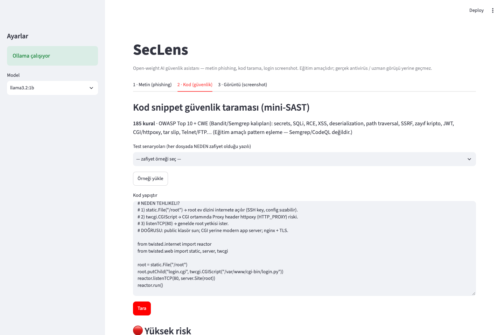
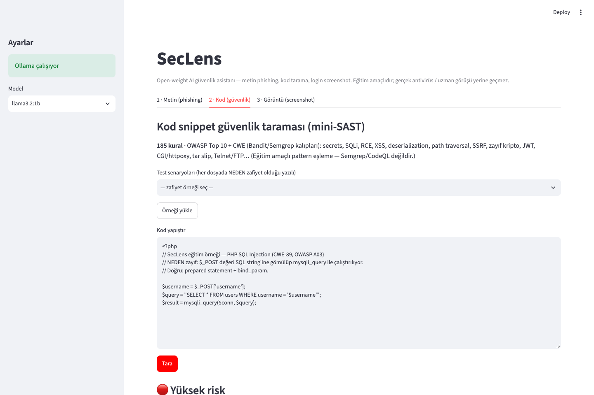
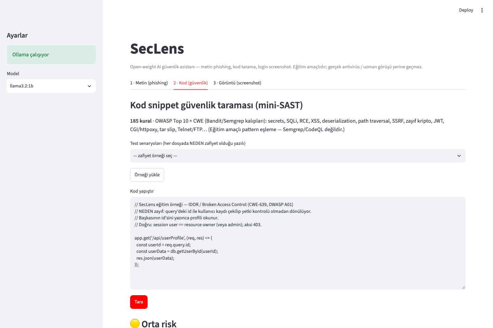

# SecLens

**Open-weight AI güvenlik asistanı** — Türkçe smishing/phishing analizi + eğitim amaçlı mini-SAST (kod tarama).

Hacktoberfest 2026 · [Best Open-Source AI Project](https://www.mlh.com/opensource-ai)  
Repo: [github.com/Mundereous/seclens](https://github.com/Mundereous/seclens)

> Eğitim / farkındalık aracı. Antivirus, banka güvenliği veya adli bilişim yerine geçmez.

| | |
|--|--|
| **TR** | [Türkçe ↓](#seclens-türkçe) |
| **EN** | [English ↓](#seclens-english) |

---

## Screenshots

### 1 · Ana ekran (Mod 1)



### 1 · Yüksek risk — sahte uzlaştırma / savcılık SMS



### 1 · Düşük risk — normal toplantı e-postası



### 1 · Yüksek risk — IBAN / EFT tuzağı



### 1 · Yüksek risk — OTP + WhatsApp / AnyDesk



### 2 · Kod — Twisted `/root` + CGI (httpoxy)



### 2 · Kod — PHP SQL Injection



### 2 · Kod — IDOR (`userProfile`)



---

<a id="seclens-english"></a>
## SecLens (English)

### What it does

| Mode | Status | Purpose |
|------|--------|---------|
| **1 · Text** | Ready | Turkish SMS/email → risk 0–100 + reasons + advice |
| **2 · Code** | Ready | Mini-SAST: ~**185** OWASP/CWE rules (Bandit/Semgrep-inspired) |
| **3 · Image** | Planned | Login-page screenshot phishing UI check |

### Architecture (no fine-tuning)

1. **Rules first** — most of the score comes from curated patterns (`core/scam_patterns.py`, `core/code_rules.py`).
2. **Open-weight LLM** via [Ollama](https://ollama.com) (`llama3.2:1b`) — Turkish explanations (Mode 1; Mode 2 optional narrative).

We did **not** fine-tune model weights. “Training” = public scam/SAST patterns turned into detectable rules.

### Mode 1 — phishing / smishing (~400+ phrase signals)

| Category | Examples | Demo |
|----------|----------|------|
| Fake bank / cargo | Block, “update”, fee + shady link | `phishing_*.txt` |
| Fake prosecution / mediation | “last day”, “call now” | `scam_uzlastirma.txt` |
| e-Devlet / public sector spoof | Suspended account + external link | `scam_edevlet.txt` |
| IBAN / EFT / “Valilik onaylı” | Personal IBAN + urgency | `scam_iban_eft.txt`, `scam_valilik_iban.txt` |
| Crypto / gift bait | Short link, “you won” | `scam_kripto.txt`, `scam_hediye_maket.txt` |
| OTP + WhatsApp / AnyDesk | “send me the SMS code” | `scam_otp_whatsapp.txt` |
| Fake tech support | Apple ID / Netflix “suspended” | `scam_tech_support.txt` |
| Forex / investment | “guaranteed daily %” | `scam_invest_forex.txt` |
| Safe controls | Meeting / friend texts | `safe_*.txt` |

Also: suspicious TLDs, IP URLs, shorteners, TR phones/IBANs, lookalike hosts, login/verify URL paths, brand+link combos.  
Extra buckets: KYC, telco/eSIM, CEO fraud, invoice/QR, refund bait, job/romance scams.

### Mode 2 — mini-SAST (~185 rules)

OWASP Top 10–oriented regex + small multi-line windows (IDOR) + XML alias tracking:

| Family | Examples |
|--------|----------|
| Secrets / crypto | Hardcoded keys, MD5/SHA1 passwords, weak TLS, JWT `none` |
| Injection | SQLi (Python/PHP/JS/Java/…), RCE, SSTI, LDAP, XSS |
| Access control | IDOR, mass assignment, path traversal, zip/tar slip |
| Deserialization | pickle, yaml.load, marshal, Java/`BinaryFormatter` |
| XXE | `xml.sax` / etree / minidom (+ `defusedxml` excluded) |
| Misconfig | Flask debug, CORS, CGI/httpoxy, Docker privileged |
| Trojan Source | Unicode bidi (CVE-2021-42574) |

Samples: `examples/code/01`–`15` + Bandit files under `examples/code/external/`.

### Model & deps

| Piece | Detail |
|-------|--------|
| Model | [`llama3.2:1b`](https://ollama.com/library/llama3.2) (small LM for the challenge) |
| Runtime | Ollama `http://127.0.0.1:11434` |
| Model license | [Llama 3.2 Community](https://www.llama.com/llama3_2/license/) |
| UI | Streamlit · HTTP `requests` · Pillow (Mode 3 later) |

Repo license **MIT**; model license stays with Meta. Weights are **not** in this repo.

### Quick start

```bash
git clone https://github.com/Mundereous/seclens.git
cd seclens
python3 -m pip install -r requirements.txt
ollama pull llama3.2:1b
streamlit run app.py
```

Open **http://127.0.0.1:8501** → Mode 1 **Analiz et** or Mode 2 **Tara**.

---

<a id="seclens-türkçe"></a>
## SecLens (Türkçe)

### Ne yapıyor?

| Mod | Durum | Ne yapar |
|-----|--------|----------|
| **1 · Metin** | Hazır | Türkçe SMS/e-posta → risk + gerekçe + öneri (**~400+** kalıp) |
| **2 · Kod** | Hazır | Mini-SAST (**~185** OWASP/CWE kuralı) |
| **3 · Görüntü** | Yakında | Login screenshot phishing UI |

### Nasıl çalışıyor?

- **Kurallar** skoru belirler (phishing + kod).  
- **Ollama + llama3.2:1b** Türkçe açıklama üretir.  
- **Fine-tune yok** — kamu uyarıları + Bandit/Semgrep kalıplarından kural seti.

### Mod 1 — neler eklendi?

Uzlaştırma, e-Devlet, kargo/gümrük, kripto, IBAN/valilik, hediye spam’e ek olarak: **OTP/WhatsApp/AnyDesk**, **tech support**, **forex**, KYC, eSIM, CEO fraud, QR/fatura, lookalike URL vb.

### Mod 2 — neler eklendi?

Secret/SQLi/XSS’ten IDOR, PHP SQLi, parola+MD5, XXE (`xml.sax`), Trojan Source, Twisted/httpoxy, tar slip, JWT, CORS… Bandit örnekleriyle karşılaştırılabilir.

### Kurulum

```bash
git clone https://github.com/Mundereous/seclens.git
cd seclens
python3 -m pip install -r requirements.txt
ollama pull llama3.2:1b
streamlit run app.py
```

---

## Project structure

```
seclens/
├── app.py                      # Streamlit UI (3 tabs)
├── requirements.txt
├── LICENSE                     # MIT
├── README.md
├── DEMO-SUNUM-NOTLARI.md
├── KOD-TEST-REHBERI.md
├── HACKTOBERFEST-BAGLAM.md
├── docs/screenshots/           # README captures
├── scripts/capture_screenshots.py
├── core/
│   ├── ollama_client.py
│   ├── phishing.py             # Mod 1 score + LLM merge
│   ├── scam_patterns.py        # TR phishing signals
│   ├── code_rules.py           # Mod 2 RULES + scan_code
│   └── code_scan.py            # Mod 2 analyze wrapper
└── examples/
    ├── scam_*.txt / safe_*.txt / phishing_*.txt
    └── code/                   # 01–15 + Bandit external/
```

Regenerate screenshots (app + Ollama running):

```bash
python3 -m pip install playwright
python3 -m playwright install chromium
python3 scripts/capture_screenshots.py
```

---

## Challenge checklist

- [x] Open-weight AI central (Ollama + Llama 3.2)  
- [x] Public GitHub + [MIT](LICENSE)  
- [x] README: what / how / model + deps + license + screenshots  
- [x] Mode 1 phishing (expanded TR rules)  
- [x] Mode 2 code mini-SAST (~185 rules)  
- [ ] Mode 3 screenshot  
- [ ] Optional cloud deploy  

---

## Ethics

- Examples are **synthetic / anonymized** — no real victim PII dumps.  
- Warn about patterns; no automated blocking or legal accusation.  
- In Turkey, suspicious SMS → **5010**.

---

## License

Code: [MIT](LICENSE) · Copyright (c) 2026 Mundereous  

Model: Llama 3.2 Community License (Meta) — via Ollama, not stored in this repo.
