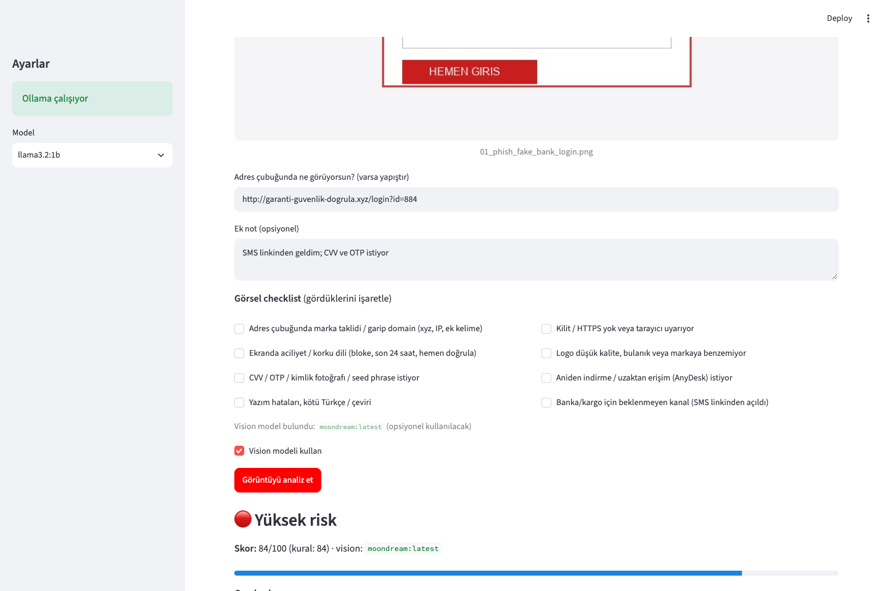
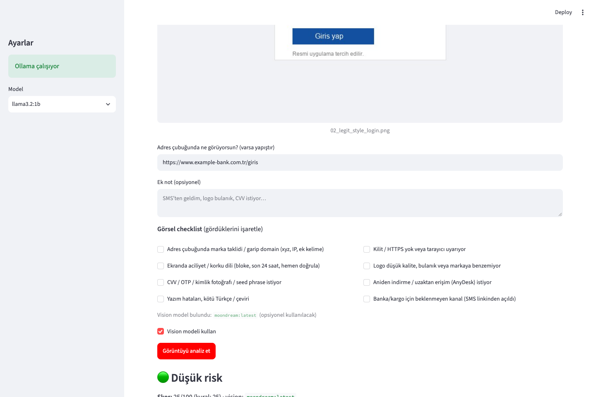
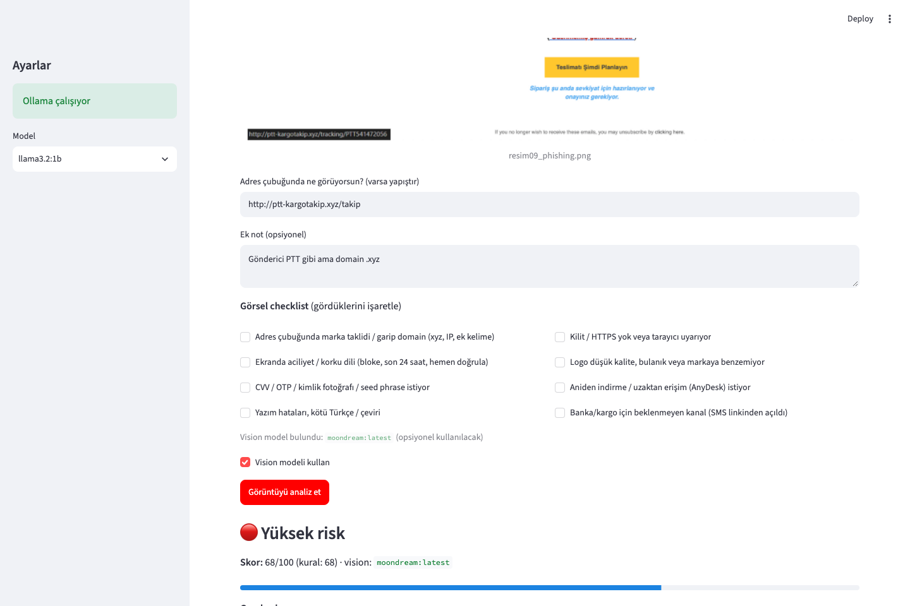

# SecLens

**Open-weight AI güvenlik asistanı** — Türkçe smishing/phishing, eğitim amaçlı mini-SAST ve login/e-posta screenshot analizi.

Hacktoberfest 2026 · [Best Open-Source AI Project](https://www.mlh.com/opensource-ai)  
Repo: [github.com/Mundereous/seclens](https://github.com/Mundereous/seclens)

> Eğitim / farkındalık aracı. Antivirus, banka güvenliği veya adli bilişim yerine geçmez.

| | |
|--|--|
| **TR** | [Türkçe ↓](#seclens-türkçe) |
| **EN** | [English ↓](#seclens-english) |

---

## Screenshots

### 1 · Ana ekran


### 1 · Yüksek risk — sahte uzlaştırma / savcılık SMS


### 1 · Düşük risk — normal toplantı e-postası


### 1 · Yüksek risk — IBAN / EFT tuzağı


### 1 · Yüksek risk — OTP + WhatsApp / AnyDesk


### 2 · Kod — Twisted `/root` + CGI (httpoxy)


### 2 · Kod — PHP SQL Injection


### 2 · Kod — IDOR (`userProfile`)


### 3 · Screenshot — sahte banka login (+ vision)



### 3 · Screenshot — meşru tarzı login



### 3 · Screenshot — e-posta phishing örneği



---

<a id="seclens-english"></a>
## SecLens (English)

### What it does

| Mode | Status | Purpose |
|------|--------|---------|
| **1 · Text** | Ready | Turkish SMS/email → risk 0–100 + reasons + advice |
| **2 · Code** | Ready | Mini-SAST: ~**185** OWASP/CWE rules |
| **3 · Image** | Ready | Screenshot phishing UI: checklist + URL/notes + **moondream** vision |

### Architecture (no fine-tuning)

1. **Rules first** — score mostly from curated patterns (`scam_patterns.py`, `code_rules.py`, screenshot checklist).
2. **Open-weight LLM** via [Ollama](https://ollama.com):
   - Text: [`llama3.2:1b`](https://ollama.com/library/llama3.2) — Turkish explanations  
   - Vision (Mode 3): [`moondream`](https://ollama.com/library/moondream) — optional visual cues  

No weight fine-tuning. “Training” = public scam/SAST patterns → detectable rules.

### Mode 1 — phishing / smishing (~400+ phrase signals)

Fake bank/cargo, prosecution SMS, e-Devlet spoof, IBAN/EFT, crypto, gift bait, OTP+WhatsApp/AnyDesk, tech support, forex, KYC, eSIM, CEO fraud, QR/invoice, lookalike URLs…  
Demos: `examples/scam_*.txt`, `examples/safe_*.txt`.

### Mode 2 — mini-SAST (~185 rules)

Secrets, SQLi/RCE/XSS, IDOR, XXE, pickle/yaml, Trojan Source (CVE-2021-42574), Twisted/httpoxy, weak password hashing…  
Samples: `examples/code/01`–`15` + Bandit under `examples/code/external/`.

### Mode 3 — screenshot phishing UI

1. Upload PNG/JPG or pick a demo / quiz-style email screenshot  
2. Fill **URL bar** + **checklist** (urgency, lookalike domain, CVV/OTP, …)  
3. Optional **moondream** vision pass  
4. Score + Turkish advice  

Samples: `examples/screenshots/` (synthetic logins + educational email quiz set under `examples/screenshots/altay/`).

### Model & deps

| Piece | Detail |
|-------|--------|
| Text model | [`llama3.2:1b`](https://ollama.com/library/llama3.2) |
| Vision model | [`moondream`](https://ollama.com/library/moondream) (Mode 3) |
| Runtime | Ollama `http://127.0.0.1:11434` |
| Licenses | [Llama 3.2 Community](https://www.llama.com/llama3_2/license/) · moondream per Ollama/model card |
| UI | Streamlit · `requests` · Pillow |

Repo: **MIT**. Model weights are **not** vendored.

### Quick start

```bash
git clone https://github.com/Mundereous/seclens.git
cd seclens
python3 -m pip install -r requirements.txt
ollama pull llama3.2:1b
ollama pull moondream          # Mode 3 vision (optional but recommended)
streamlit run app.py
```

Open **http://127.0.0.1:8501** → Mode 1 **Analiz et** · Mode 2 **Tara** · Mode 3 **Görüntüyü analiz et**.

---

<a id="seclens-türkçe"></a>
## SecLens (Türkçe)

### Ne yapıyor?

| Mod | Durum | Ne yapar |
|-----|--------|----------|
| **1 · Metin** | Hazır | Türkçe SMS/e-posta → risk + gerekçe (**~400+** kalıp) |
| **2 · Kod** | Hazır | Mini-SAST (**~185** OWASP/CWE kuralı) |
| **3 · Görüntü** | Hazır | Screenshot: checklist + URL + **moondream** vision |

### Nasıl çalışıyor?

- Skorun çoğu **kurallardan** gelir.  
- **llama3.2:1b** Türkçe gerekçe yazar.  
- **moondream** (kuruluysa) görsele bakar.  
- Fine-tune yok.

### Kurulum

```bash
git clone https://github.com/Mundereous/seclens.git
cd seclens
python3 -m pip install -r requirements.txt
ollama pull llama3.2:1b
ollama pull moondream
streamlit run app.py
```

---

## Project structure

```
seclens/
├── app.py
├── requirements.txt
├── LICENSE
├── README.md
├── docs/screenshots/              # README UI captures (01–11)
├── scripts/
│   ├── capture_screenshots.py
│   └── test_altay_quiz.py
├── core/
│   ├── phishing.py / scam_patterns.py
│   ├── code_rules.py / code_scan.py
│   ├── screenshot_scan.py
│   └── ollama_client.py           # chat + chat_vision
└── examples/
    ├── scam_*.txt / safe_*.txt
    ├── code/
    └── screenshots/               # Mod 3 demos + quiz-style set
```

Regenerate README screenshots (app + Ollama running):

```bash
python3 -m pip install playwright && python3 -m playwright install chromium
python3 scripts/capture_screenshots.py
```

---

## Challenge checklist

- [x] Open-weight AI central (Ollama + Llama 3.2 + moondream)  
- [x] Public GitHub + [MIT](LICENSE)  
- [x] README: what / how / models + deps + screenshots  
- [x] Mode 1 / 2 / 3 working  
- [ ] Optional cloud deploy  

---

## Ethics

- Text/code samples are **synthetic / anonymized**.  
- Screenshot quiz-style images are for **education/awareness**; see `examples/screenshots/altay/README.md` for source attribution.  
- No automated blocking or legal accusation. Suspicious SMS in TR → **5010**.

---

## License

Code: [MIT](LICENSE) · Copyright (c) 2026 Mundereous  

Models: via Ollama (not stored in this repo) — Llama 3.2 Community · moondream per upstream terms.
